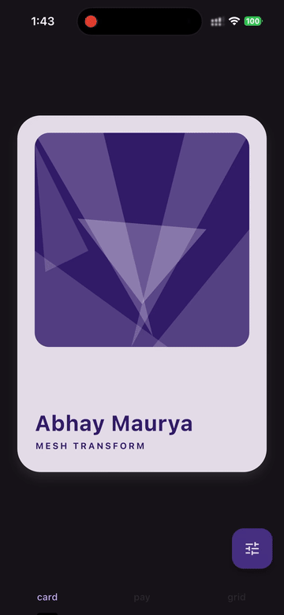
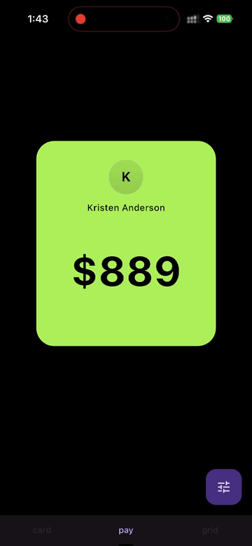
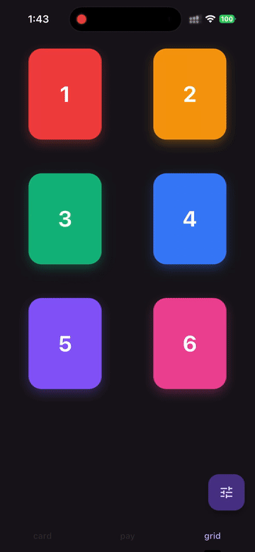

<h1 align="center">Flutter Mesh Transform 🌊</h1>

<p align="center">A drop-in mesh distortion / warp effect for any Flutter widget.</p>

<p align="center">
Driven by a spring simulation and a fragment shader — flip a <code>bool</code> and the wrapped widget warps in or out.
</p>

<p align="center">
  
  
  
</p>

<p align="center">
  
  
  
</p>

---

```yaml
dependencies:
  flutter_mesh_transform: ^0.1.0
```

```dart
import 'package:flutter_mesh_transform/flutter_mesh_transform.dart';

MeshTransform(
  active: isOpen,
  child: YourWidget(),
);
```

The widget owns its spring controller and caches the compiled shader program across instances, so it's safe to mount many of them.

## 🎚️ API

`MeshTransform` parameters:

| Parameter      | Default                                                | Notes                                                                  |
| -------------- | ------------------------------------------------------ | ---------------------------------------------------------------------- |
| `active`       | required                                               | When this flips, the warp animates between 0 and 1.                    |
| `child`        | required                                               | The widget to warp.                                                    |
| `xSpread`      | `2.1`                                                  | Horizontal warp width.                                                 |
| `yFalloff`     | `3.0`                                                  | How quickly the warp falls off vertically.                             |
| `yTravel`      | `1.1`                                                  | Vertical displacement.                                                 |
| `response`     | `0.85`                                                 | Spring response (seconds). Lower = snappier.                           |
| `dampingRatio` | `0.75`                                                 | Spring damping. 1.0 = critical.                                        |
| `maxBlur`      | `20.0`                                                 | Peak blur sigma at `active = true`. Set to `0` to disable.             |
| `padding`      | `EdgeInsets.symmetric(vertical: 40, horizontal: 24)`   | Empty space around the child captured by the shader so it doesn't clip. |

## 🚀 Example

A runnable demo app with interactive sliders for every parameter lives in [`example/`](example/):

```bash
cd example
flutter run
```

## 📄 License

BSD 3-Clause. See [LICENSE](LICENSE).
